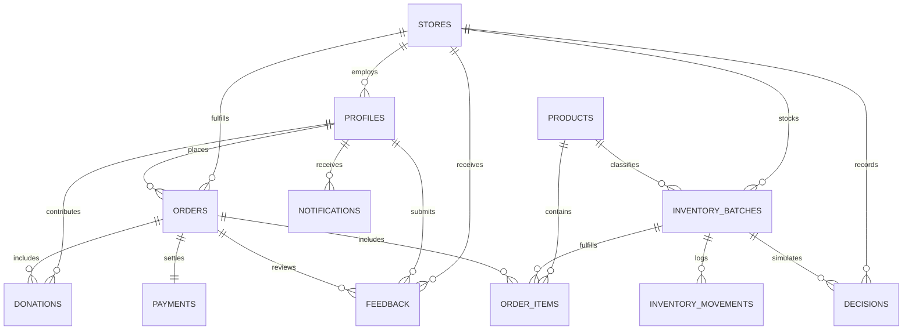

# FYND × NMIMS Hyderabad — C30: Database Schema Specification

## 1. Architectural Philosophy & Principles

The database architecture for the **Perishable Stock Recovery Desk** enforces strict data integrity, FSSAI-aligned food safety guardrails, and precise accounting rules:

1. **Integer Money Storage (Paise):**
   - Floating-point representations (e.g. `FLOAT`, `REAL`, `DOUBLE PRECISION`) suffer from IEEE 754 precision issues (e.g. `0.1 + 0.2 = 0.30000000000000004`).
   - Every monetary figure (prices, costs, subtotals, discounts, donations) is stored as an `INTEGER` representing Indian Paise ($1\text{ INR} = 100\text{ paise}$).
   - Examples: ₹40.00 $\rightarrow$ `4000`, ₹25.00 $\rightarrow$ `2500`, ₹1.00 $\rightarrow$ `100`.

2. **Immutable Audit Trails:**
   - Orders, order item price snapshots, payment receipts, and manager markdown decisions are immutable once created.
   - Prices on order items are captured at the exact moment of order placement (`unit_price_paise`, `original_price_paise`).

3. **Database-Tier Food Safety Guarantees:**
   - Customer-facing queries are prevented by Row Level Security (RLS) from ever retrieving expired batches (`expiry_at <= now()`), physically damaged batches (`condition = 'damaged'`), or compromised cold-chain batches (`cold_chain_status = 'exception'`).

---

## 2. Entity Relationship Diagram (ERD)

---

## 3. Detailed Table Definitions

### 3.1 `stores`
Represents physical café or retail locations.

| Column | Type | Constraints | Description |
|---|---|---|---|
| `id` | `UUID` | PRIMARY KEY | Unique store identifier |
| `code` | `TEXT` | UNIQUE, NOT NULL | Human-readable store code (e.g. `HYD-BH-01`) |
| `name` | `TEXT` | NOT NULL | Store display name |
| `address` | `TEXT` | | Physical street address |
| `city` | `TEXT` | NOT NULL DEFAULT `'Hyderabad'` | Store city |
| `state` | `TEXT` | NOT NULL DEFAULT `'Telangana'` | Store state |
| `postal_code` | `TEXT` | | Postal / PIN code |
| `phone` | `TEXT` | | Store contact phone number |
| `min_contribution_floor_paise` | `INTEGER` | NOT NULL DEFAULT `500` | Minimum recovery floor per unit in paise (₹5.00) |
| `created_at` | `TIMESTAMPTZ` | NOT NULL DEFAULT `now()` | Record creation timestamp |
| `updated_at` | `TIMESTAMPTZ` | NOT NULL DEFAULT `now()` | Last modification timestamp |

---

### 3.2 `profiles`
User profiles extending Supabase `auth.users`.

| Column | Type | Constraints | Description |
|---|---|---|---|
| `id` | `UUID` | PRIMARY KEY, FK `auth.users(id)` | Maps 1:1 with Supabase Auth |
| `email` | `TEXT` | UNIQUE, NOT NULL | Account email address |
| `full_name` | `TEXT` | | User display name |
| `phone` | `TEXT` | | User contact phone number |
| `role` | `TEXT` | NOT NULL DEFAULT `'customer'` | Role: `'customer'`, `'manager'`, `'admin'` |
| `store_id` | `UUID` | FK `stores(id)` | Store assignment for managers |
| `avatar_url` | `TEXT` | | Optional profile picture URL |
| `created_at` | `TIMESTAMPTZ` | NOT NULL DEFAULT `now()` | Registration timestamp |
| `updated_at` | `TIMESTAMPTZ` | NOT NULL DEFAULT `now()` | Profile update timestamp |

---

### 3.3 `products`
Master catalog items defining standard perishable goods.

| Column | Type | Constraints | Description |
|---|---|---|---|
| `id` | `UUID` | PRIMARY KEY | Unique product ID |
| `sku` | `TEXT` | UNIQUE, NOT NULL | Stock keeping unit (e.g. `OGY-200`) |
| `name` | `TEXT` | NOT NULL | Product name |
| `category` | `TEXT` | NOT NULL | Dairy, Produce, Bakery, Beverages |
| `description` | `TEXT` | | Product details & ingredients |
| `image_emoji` | `TEXT` | DEFAULT `'📦'` | Emoji icon for fast UI rendering |
| `image_url` | `TEXT` | | Optional CDN photo asset |
| `base_price_paise` | `INTEGER` | NOT NULL, >= 0 | Standard retail selling price in paise |
| `default_incremental_cost_paise` | `INTEGER` | NOT NULL, >= 0 | Cost floor for contribution checks in paise |
| `max_markdown_percent` | `INTEGER` | NOT NULL DEFAULT `50` | Maximum permissible markdown % (0–90) |
| `is_perishable` | `BOOLEAN` | NOT NULL DEFAULT `true` | Perishability flag |
| `shelf_life_hours` | `INTEGER` | DEFAULT `48` | Expected shelf life in hours |
| `unit_of_measure` | `TEXT` | NOT NULL DEFAULT `'unit'` | Unit label (e.g. pack, unit, bottle) |
| `created_at` | `TIMESTAMPTZ` | NOT NULL DEFAULT `now()` | Record creation timestamp |

---

### 3.4 `inventory_batches`
Physical inventory batches with expiry dates and cold-chain status.

| Column | Type | Constraints | Description |
|---|---|---|---|
| `id` | `UUID` | PRIMARY KEY | Unique batch ID |
| `batch_code` | `TEXT` | NOT NULL | Code identifier (e.g. `B1`, `B2`) |
| `store_id` | `UUID` | NOT NULL, FK `stores(id)` | Owning store |
| `product_id` | `UUID` | NOT NULL, FK `products(id)` | Referenced catalog product |
| `initial_quantity` | `INTEGER` | NOT NULL, >= 0 | Units originally received |
| `available_quantity` | `INTEGER` | NOT NULL, >= 0 | Units currently in stock |
| `allocated_quantity` | `INTEGER` | NOT NULL DEFAULT `0`, >= 0 | Units currently allocated to active recovery |
| `original_price_paise` | `INTEGER` | NOT NULL, >= 0 | Batch baseline retail price in paise |
| `incremental_cost_paise` | `INTEGER` | NOT NULL, >= 0 | Unit incremental cost in paise |
| `current_selling_price_paise` | `INTEGER` | NOT NULL, >= 0 | Active markdown or standard price in paise |
| `max_allowed_markdown_percent` | `INTEGER` | NOT NULL DEFAULT `50` | Allowed ceiling markdown % |
| `expiry_at` | `TIMESTAMPTZ` | NOT NULL | Precise expiration timestamp |
| `received_at` | `TIMESTAMPTZ` | NOT NULL DEFAULT `now()` | Stock arrival time |
| `condition` | `TEXT` | NOT NULL DEFAULT `'good'` | `'good'`, `'fair'`, `'damaged'` |
| `cold_chain_status` | `TEXT` | NOT NULL DEFAULT `'compliant'` | `'compliant'`, `'exception'`, `'unknown'` |
| `notes` | `TEXT` | | Operational observations |
| `created_at` | `TIMESTAMPTZ` | NOT NULL DEFAULT `now()` | Batch creation time |

---

### 3.5 `orders`
Customer checkout transactions.

| Column | Type | Constraints | Description |
|---|---|---|---|
| `id` | `UUID` | PRIMARY KEY | Order ID |
| `order_number` | `TEXT` | UNIQUE, NOT NULL | Human-friendly order number |
| `store_id` | `UUID` | NOT NULL, FK `stores(id)` | Fulfilling store |
| `customer_id` | `UUID` | FK `profiles(id)` | Buyer profile ID |
| `customer_name` | `TEXT` | NOT NULL | Customer name |
| `customer_email` | `TEXT` | | Contact email |
| `customer_phone` | `TEXT` | | Contact phone |
| `status` | `TEXT` | NOT NULL DEFAULT `'pending'` | `'pending'`, `'confirmed'`, `'processing'`, `'ready_for_pickup'`, `'completed'`, `'cancelled'` |
| `subtotal_paise` | `INTEGER` | NOT NULL, >= 0 | Items gross total in paise |
| `discount_paise` | `INTEGER` | NOT NULL DEFAULT `0`, >= 0 | Markdown savings in paise |
| `donation_amount_paise` | `INTEGER` | NOT NULL DEFAULT `0`, >= 0 | ₹1 optional donation in paise (100) |
| `total_paise` | `INTEGER` | NOT NULL, >= 0 | Final payable total in paise |
| `payment_status` | `TEXT` | NOT NULL DEFAULT `'pending'` | `'pending'`, `'authorized'`, `'captured'`, `'failed'`, `'refunded'` |
| `payment_id` | `TEXT` | | Gateway reference |
| `notes` | `TEXT` | | Customer delivery or pickup instructions |
| `created_at` | `TIMESTAMPTZ` | NOT NULL DEFAULT `now()` | Order placement time |

---

### 3.6 `order_items`
Individual line items inside an order with immutable pricing snapshots.

| Column | Type | Constraints | Description |
|---|---|---|---|
| `id` | `UUID` | PRIMARY KEY | Line item ID |
| `order_id` | `UUID` | NOT NULL, FK `orders(id)` | Parent order |
| `batch_id` | `UUID` | FK `inventory_batches(id)` | Sourced batch |
| `product_id` | `UUID` | FK `products(id)` | Catalog product |
| `product_name` | `TEXT` | NOT NULL | Item name snapshot |
| `quantity` | `INTEGER` | NOT NULL, > 0 | Number of units purchased |
| `unit_price_paise` | `INTEGER` | NOT NULL, >= 0 | Effective unit price charged |
| `original_price_paise` | `INTEGER` | NOT NULL, >= 0 | Unit list price before markdown |
| `discount_percent` | `INTEGER` | NOT NULL DEFAULT `0` | Markdown percentage applied |
| `line_total_paise` | `INTEGER` | NOT NULL, >= 0 | `quantity * unit_price_paise` |
| `created_at` | `TIMESTAMPTZ` | NOT NULL DEFAULT `now()` | Creation timestamp |

---

### 3.7 `payments`
Gateway transaction logs (Razorpay).

| Column | Type | Constraints | Description |
|---|---|---|---|
| `id` | `UUID` | PRIMARY KEY | Internal payment ID |
| `order_id` | `UUID` | NOT NULL, FK `orders(id)` | Associated order |
| `gateway` | `TEXT` | NOT NULL DEFAULT `'razorpay'` | Payment gateway |
| `gateway_order_id` | `TEXT` | | Razorpay `order_id` |
| `gateway_payment_id` | `TEXT` | UNIQUE | Razorpay `payment_id` |
| `gateway_signature` | `TEXT` | | Cryptographic HMAC-SHA256 signature |
| `amount_paise` | `INTEGER` | NOT NULL, > 0 | Amount paid in paise |
| `currency` | `TEXT` | NOT NULL DEFAULT `'INR'` | Currency code |
| `status` | `TEXT` | NOT NULL | `'pending'`, `'success'`, `'failed'`, `'refunded'` |
| `verified_at` | `TIMESTAMPTZ` | | Signature verification timestamp |
| `raw_response` | `JSONB` | | Sanitized gateway payload |
| `created_at` | `TIMESTAMPTZ` | NOT NULL DEFAULT `now()` | Transaction creation timestamp |

---

### 3.8 `donations`
₹1 opt-in micro-donations supporting community food rescue.

| Column | Type | Constraints | Description |
|---|---|---|---|
| `id` | `UUID` | PRIMARY KEY | Donation record ID |
| `order_id` | `UUID` | NOT NULL, FK `orders(id)` | Associated order |
| `customer_id` | `UUID` | FK `profiles(id)` | Donor profile |
| `customer_name` | `TEXT` | NOT NULL | Donor name |
| `amount_paise` | `INTEGER` | NOT NULL DEFAULT `100` | 100 paise = ₹1.00 INR |
| `program_name` | `TEXT` | NOT NULL | Recovery program designation |
| `partner_ngo` | `TEXT` | DEFAULT `'Akshaya Patra Foundation'` | Distributing NGO partner |
| `payment_verified` | `BOOLEAN` | NOT NULL DEFAULT `false` | True only once order payment succeeds |
| `verified_at` | `TIMESTAMPTZ` | | Payment verification timestamp |
| `created_at` | `TIMESTAMPTZ` | NOT NULL DEFAULT `now()` | Record creation timestamp |

---

### 3.9 `notifications`
Multi-channel notification inbox for both customers and managers.

| Column | Type | Constraints | Description |
|---|---|---|---|
| `id` | `UUID` | PRIMARY KEY | Notification ID |
| `user_id` | `UUID` | NOT NULL, FK `profiles(id)` | Recipient user |
| `title` | `TEXT` | NOT NULL | Notification headline |
| `message` | `TEXT` | NOT NULL | Body copy |
| `type` | `TEXT` | NOT NULL | `'info'`, `'order'`, `'donation'`, `'alert'`, `'feedback'` |
| `related_entity_type` | `TEXT` | | e.g. `'order'`, `'batch'`, `'feedback'` |
| `related_entity_id` | `UUID` | | Target entity ID |
| `is_read` | `BOOLEAN` | NOT NULL DEFAULT `false` | Read status flag |
| `created_at` | `TIMESTAMPTZ` | NOT NULL DEFAULT `now()` | Sent timestamp |

---

### 3.10 `feedback`
Post-purchase customer ratings and manager responses.

| Column | Type | Constraints | Description |
|---|---|---|---|
| `id` | `UUID` | PRIMARY KEY | Feedback ID |
| `customer_id` | `UUID` | FK `profiles(id)` | Reviewer profile |
| `customer_name` | `TEXT` | NOT NULL | Reviewer display name |
| `store_id` | `UUID` | FK `stores(id)` | Store being reviewed |
| `order_id` | `UUID` | FK `orders(id)` | Optional order reference |
| `rating` | `INTEGER` | NOT NULL, 1 to 5 | 1–5 star rating |
| `category` | `TEXT` | NOT NULL DEFAULT `'general'` | Review topic |
| `message` | `TEXT` | NOT NULL, >= 5 chars | Written comment |
| `status` | `TEXT` | NOT NULL DEFAULT `'submitted'` | `'submitted'`, `'reviewed'`, `'resolved'` |
| `manager_response` | `TEXT` | | Store manager's reply |
| `responded_by` | `UUID` | FK `profiles(id)` | Manager user ID |
| `responded_at` | `TIMESTAMPTZ` | | Reply timestamp |
| `created_at` | `TIMESTAMPTZ` | NOT NULL DEFAULT `now()` | Feedback creation timestamp |

---

### 3.11 `inventory_movements`
Full audit trail tracking every unit decrement, markdown, and write-off.

| Column | Type | Constraints | Description |
|---|---|---|---|
| `id` | `UUID` | PRIMARY KEY | Movement ID |
| `batch_id` | `UUID` | NOT NULL, FK `inventory_batches(id)` | Target batch |
| `movement_type` | `TEXT` | NOT NULL | `'receive'`, `'sale'`, `'markdown'`, `'write_off'`, `'donation'`, `'audit_correction'` |
| `quantity_change` | `INTEGER` | NOT NULL | Delta (+/- units) |
| `previous_quantity` | `INTEGER` | NOT NULL | Quantity before movement |
| `new_quantity` | `INTEGER` | NOT NULL | Quantity after movement |
| `price_paise` | `INTEGER` | | Transaction unit price in paise |
| `reason` | `TEXT` | | Operational justification |
| `recorded_by` | `UUID` | FK `profiles(id)` | Staff member recording movement |
| `created_at` | `TIMESTAMPTZ` | NOT NULL DEFAULT `now()` | Log timestamp |

---

### 3.12 `decisions`
Manager markdown simulations recorded through the Decision Engine.

| Column | Type | Constraints | Description |
|---|---|---|---|
| `id` | `UUID` | PRIMARY KEY | Decision ID |
| `batch_id` | `UUID` | FK `inventory_batches(id)` | Subject batch |
| `batch_code` | `TEXT` | NOT NULL | Batch code (e.g. `B1`) |
| `store_id` | `UUID` | NOT NULL, FK `stores(id)` | Store location |
| `action_type` | `TEXT` | NOT NULL | `'MARKDOWN_SALE'`, `'DONATE'`, `'DISCARD'`, `'MAINTAIN_PRICE'` |
| `proposed_price_paise` | `INTEGER` | NOT NULL | Simulated price in paise |
| `allocated_quantity` | `INTEGER` | NOT NULL | Units allocated |
| `supported_demand` | `INTEGER` | NOT NULL | Supported market demand |
| `unit_contribution_paise` | `INTEGER` | NOT NULL | Unit margin in paise |
| `total_contribution_paise` | `INTEGER` | NOT NULL | Total recovery contribution in paise |
| `reasoning` | `TEXT` | | Manager notes & rationale |
| `compliance_checked` | `BOOLEAN` | NOT NULL DEFAULT `true` | Passed food-safety verification |
| `created_by` | `UUID` | FK `profiles(id)` | Manager profile |
| `created_at` | `TIMESTAMPTZ` | NOT NULL DEFAULT `now()` | Execution timestamp |
