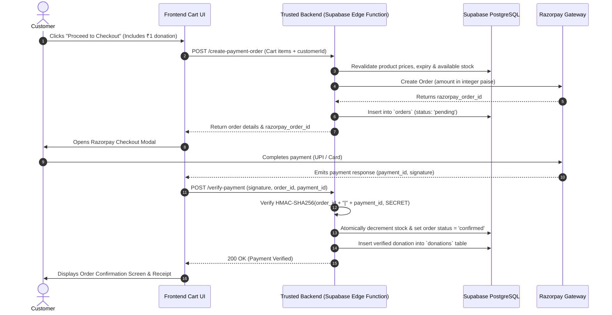

# Razorpay Payment Gateway Integration Runbook

## 1. Overview & Architecture

The **Perishable Stock Recovery Desk** uses **Razorpay** as its primary payment processor for Indian retail transactions ($INR$), supporting UPI, Cards, Net Banking, and Wallets.

The integration is built around strict data integrity rules:
1. **Zero Client Trust:** Final order amounts, item prices, and eligible quantities are validated against the database before payment creation.
2. **Atomic Inventory Reservation:** Stock is decremented only when payment is captured.
3. **Verified ₹1 Donation Ledger:** The optional ₹1 contribution is recorded in the donation ledger *only after* payment verification succeeds.

---

## 2. API Key Hygiene & Environment Configuration

Razorpay issues two credentials:
- **Key ID (`rzp_test_...` or `rzp_live_...`):** Safe for client-side embedding. Placed in `.env` as `VITE_RAZORPAY_KEY_ID`.
- **Key Secret:** **RESTRICTED.** Must NEVER be exposed to the browser or committed to source control. It is used exclusively inside trusted server environments (e.g. Supabase Edge Functions) for signature verification.

### `.env` Setup:
```bash
# Razorpay Client-Safe Public Key
VITE_RAZORPAY_KEY_ID=rzp_test_51Abcdef123456
```

---

## 3. End-to-End Checkout Workflow



---

## 4. Idempotency & Failure Handling

1. **Duplicate Webhook Prevention:**
   The `payments` table enforces a `UNIQUE` constraint on `gateway_payment_id`. Repeated webhook invocations for the same transaction resolve idempotently without duplicating stock decrements or donations.
2. **Abandoned Checkouts:**
   Pending orders that receive no successful payment confirmation expire automatically and release reserved quantities.
3. **Food Safety Interceptor:**
   If a batch expires while an item sits in a customer's cart, backend pre-payment validation rejects order creation with error: `"Batch expired: item is no longer sellable"`.

---

## 5. Demo / Sandbox Mode Fallback

When live Razorpay credentials are not yet configured:
- The application automatically switches to **Sandbox Demo Mode**.
- Checkout displays simulated processing with realistic network latency.
- Order snapshots, payment IDs, and verified donations are persisted to the local adapter without requiring external network connectivity.
